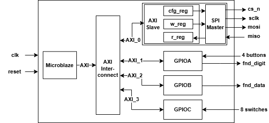
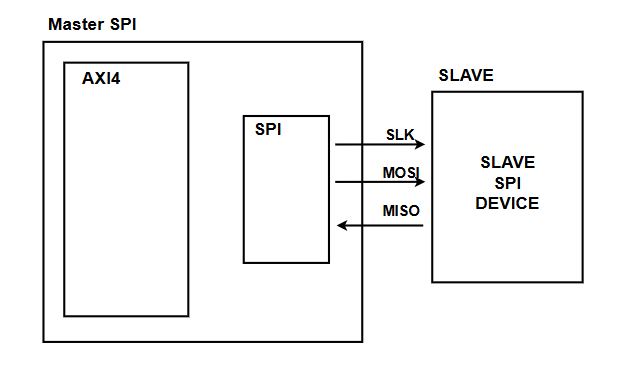
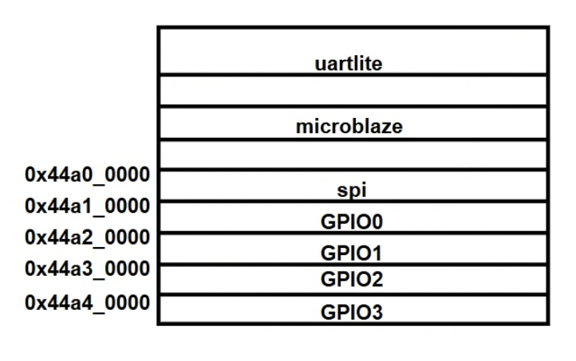
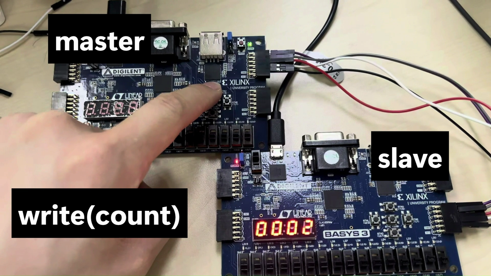
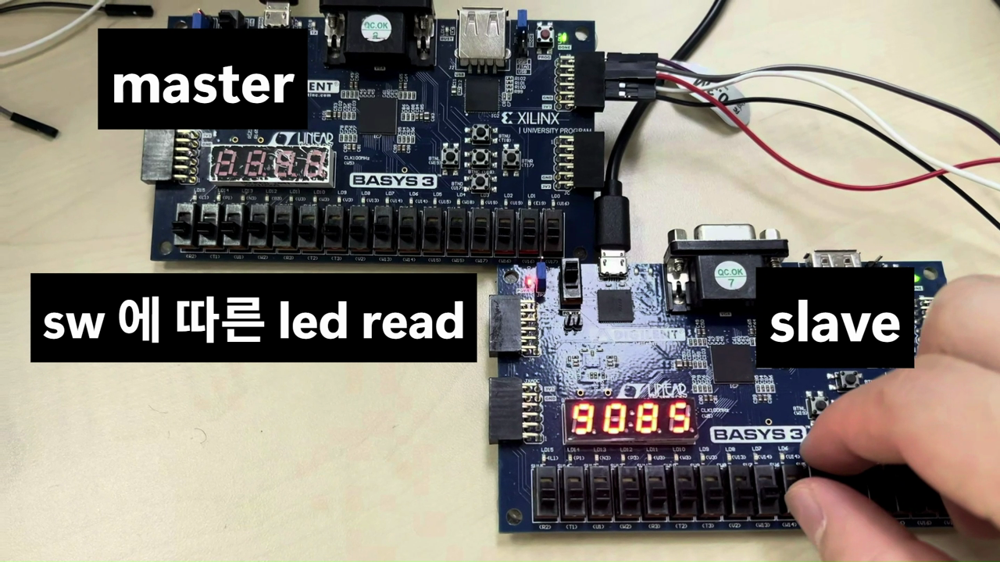

# 🔌 AXI4-Lite SPI Master IP — MicroBlaze SoC Integration

[-orange.svg)]()

> **SPI Master를 AMBA AXI4-Lite 슬레이브 IP로 패키징해 MicroBlaze SoC에 통합하고, Basys 3 두 보드 간 SPI 통신을 구현한 프로젝트**
> 기존 APB 기반 SPI 설계를 AXI 버스로 확장하여 AXI Master/Slave 핸드셰이크 FSM 설계부터 Vivado IP 통합, FPGA 보드 구동까지 수행했습니다.

---

## 📋 Table of Contents
1. [Project Overview](#-project-overview)
2. [Background: SPI, AXI](#-background-spi-axi)
3. [System Architecture](#-system-architecture)
4. [FPGA Implementation](#-fpga-implementation)
5. [Troubleshooting](#-troubleshooting)
6. [Lessons Learned](#-lessons-learned)

---

## 📌 Project Overview

* **목표**: SPI Master를 AXI4-Lite 슬레이브 IP로 만들고, MicroBlaze 소프트웨어(C)에서 레지스터 맵을 통해 제어하는 SoC 구성.
* **팀**: 2인 (강혜빈, 윤정원)
* **구성 요소**

| 구분 | 역할 | 사용 IP |
| :--- | :--- | :--- |
| **SPI** | SPI Master (`cs_n`, `sclk`, `mosi`, `miso`) | `SPI1.0.v` (패키징 IP) |
| **GPIO** | 버튼 / 스위치 입력, FND 출력 | `GPIO1.0.v` (패키징 IP) |
| **UART** | PC ↔ FPGA 메시지, 로그 출력 | `axi_uartlite` |

---

## 📚 Background: SPI, AXI

### SPI

| Mode | CPOL | CPHA | 설명 |
| :---: | :---: | :---: | :--- |
| 0 | 0 | 0 | 평상시 Low, **상승** 엣지(Rising)에서 데이터 샘플링 |
| 1 | 0 | 1 | 평상시 Low, **하강** 엣지(Falling)에서 데이터 샘플링 |
| 2 | 1 | 0 | 평상시 High, **하강** 엣지(Falling)에서 데이터 샘플링 |
| 3 | 1 | 1 | 평상시 High, **상승** 엣지(Rising)에서 데이터 샘플링 |

* **Full-Duplex**: 동시 송수신 가능
* **인터페이스 4선**: `SCLK`, `MOSI`, `MISO`, `SS`
* CPOL, CPHA 설정에 따라 Mode 0–3의 4가지 조합 지원

### AXI (AMBA AXI4)

| 특징 | 설명 |
| :--- | :--- |
| 모듈형 IP 통합 | 표준화된 AXI 인터페이스를 사용해 IP를 플랫폼에 통합 |
| 병렬 처리 | **5개의 독립 채널** 활용 |
| 통신 효율 | **READ / WRITE 채널 분리** |
| 핸드셰이크 | `VALID` / `READY` 프로토콜 |

| Channel | 방향 | 설명 |
| :--- | :--- | :--- |
| **Write Address (AW)** | Master → Slave | 쓸 주소와 제어 정보 전송 |
| **Write Data (W)** | Master → Slave | 기록할 데이터 전송 |
| **Write Response (B)** | Slave → Master | 데이터 수신 및 쓰기 완료 후 성공 여부 전달 |
| **Read Address (AR)** | Master → Slave | 읽어올 주소와 제어 정보 전송 |
| **Read Data (R)** | Slave → Master | 요청받은 주소에서 읽은 데이터를 Master로 전송 |

**VALID & READY 핸드셰이크**의 장점

* 두 신호가 모두 1일 때만 데이터가 전달되므로 **데이터 유실이 없음**.
* 장치 간 속도 차이가 있어도 오류 없이 통신 가능.
* 서로의 신호를 확인하고 진행하므로 **Deadlock 방지**.

  

| 시점 | 동작 |
| :---: | :--- |
| T0 | 시스템 초기 상태 |
| T1 | Source 준비 및 전송 시작 (`VALID` 상승) |
| T2 | Destination이 신호를 인지하고 `READY` 준비 |
| T3 | **Handshake 발생** (데이터 전송 완료) |
| T4 | 전송 종료 및 `IDLE` 복귀 |

---

## 🧩 System Architecture

### 1. AXI4-Lite Master / Slave FSM

CPU 측 사용자 인터페이스(`transfer`, `ready`, `addr`, `wdata`, `write`, `rdata`)를 AXI4-Lite 채널 신호로 변환하는 **Master**와 레지스터 블록을 가진 **Slave**를 FSM으로 설계했습니다. Write(AW → W → B)와 Read(AR → R) 트랜잭션을 각각 독립된 상태 머신으로 구성했습니다.

  

  
  

### 2. SoC Block Diagram

MicroBlaze가 AXI Interconnect를 통해 각 주변장치를 제어합니다. SPI Master IP는 AXI Slave 내부에 `cfg_reg`, `w_reg`, `r_reg` 레지스터를 두고 SPI Master를 구동합니다.

  

  

### 3. Memory Map (Memory-Mapped I/O)

주변장치는 `0x44A0_0000`부터 `64 KB` 간격으로 배치됩니다.

| 주소 | 장치 |
| :---: | :---: |
| `0x44A0_0000` | SPI |
| `0x44A1_0000` | GPIO0 |
| `0x44A2_0000` | GPIO1 |
| `0x44A3_0000` | GPIO2 |
| `0x44A4_0000` | GPIO3 |

  

### 4. Software Layered Architecture

하위 모듈을 세분화한 계층 구조로 MicroBlaze 소프트웨어를 구성했습니다.

  

| Layer | 구성 |
| :--- | :--- |
| **Application** | I2C, SPI 등 |
| **Driver** | FND, BTN, LED, COMMON |
| **HAL** | GPIO, TIM |
| **HW** | FND, BUTTON, LED |

---

## 🎬 FPGA Implementation

### SPI — Master / Slave 2-Board Test (Basys 3 × 2)

* 마스터 보드에서 `write(count)`를 수행하면 슬레이브 보드의 FND에 값이 표시되고, 카운트가 9를 넘으면 0으로 초기화되는 동작을 확인.
* 슬레이브 보드의 스위치 값에 따라 마스터가 `led read`로 값을 읽어 LED에 반영.

  
  

> ▶ **[SPI 구현 영상 보기](docs/implementation_spi.mp4)**

---

## 🔧 Troubleshooting

| # | 문제 현상 (Issue) | 원인 및 해결 |
| --- | --- | --- |
| **1** | **`edge_detector` 오류** | _(원인 및 해결 과정을 직접 작성해 주세요)_ |
| **2** | **Slave timing 오류** | _(원인 및 해결 과정을 직접 작성해 주세요)_ |

---

## 💡 Lessons Learned

* UVM은 class 개념과 Synopsys 툴이 낯설었지만, 반복하면서 환경 구조(agent, scoreboard, coverage)를 이해하게 되었습니다.
* APB에서 AXI로 넘어가면서 신호 수와 고려할 사항(채널 분리, 핸드셰이크)이 크게 늘었습니다.
* 소프트웨어(MicroBlaze C)를 통한 동작 확인이 가장 어려웠고, C/Python 학습을 통해 보완할 계획입니다.

---

## 👨‍💻 Author

- **GitHub**: [@ethan000106](https://github.com/ethan000106)
