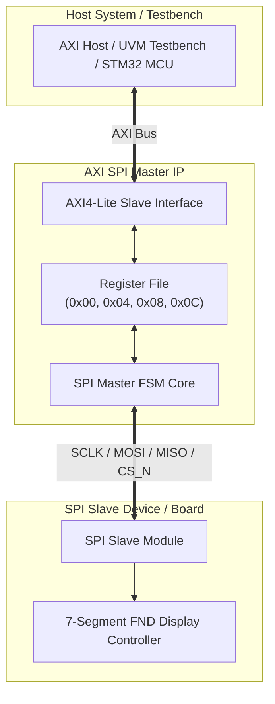

# ⚡ AXI Lite SPI System & UVM Verification IP

AXI4-Lite 기반의 **SPI Master Controller IP**, **SPI Slave 디바이스**, **UVM 1.2 검증 환경**, 그리고 **STM32 MCU / MicroBlaze 연동용 C/C++ 펌웨어 드라이버**를 포함하는 Full-Stack SoC Peripheral IP 및 Verification 프로젝트입니다.

---

## 🚀 Key Features

* **AXI4-Lite Interface**: 32-bit AXI4-Lite 슬레이브 버스 인터페이스 제공
* **Configurable SPI Core**:
* Programmable Clock Divider (`clk_div`)
* Configurable SPI Modes (`CPOL`, `CPHA` 설정 가능)
* Full-Duplex 8-bit Data Transfer
* CS (Chip Select) & Bus Busy/Done Status Monitoring


* **Complete UVM Verification Environment**:
* UVM Agent (Driver, Monitor, Sequencer)
* Comprehensive Scoreboard & Functional Coverage (`covergroup`)
* Transaction-Level Modeling (TLM 1.0) 기반 검증


* **FPGA & Embedded SW Support**:
* **STM32 MCU (ARM Cortex-M) 및 MicroBlaze 기반 C/C++ Bare-metal/HAL 펌웨어 드라이버 제공**
* Xilinx Basys-3 Board Constraint (`Basys-3-Master.xdc`) 및 7-Segment FND Display Controller 포함


---

## 🏛️ System Architecture



---

## 📋 Register Map

| Offset | Register Name | R/W | Bit Field | Description |
| --- | --- | --- | --- | --- |
| `0x00` | **TX_DATA** | W/R | `[7:0]` | SPI Transmit Data Byte |
| `0x04` | **CONTROL** | W/R | `[0]` | **Start Trigger** (Rising edge pulse launches transmission) |
|  |  |  | `[1]` | **CPOL** (Clock Polarity: 0 = Idle Low, 1 = Idle High) |
|  |  |  | `[2]` | **CPHA** (Clock Phase: 0 = 1st Edge, 1 = 2nd Edge Sampling) |
|  |  |  | `[15:8]` | **CLK_DIV** (SCLK Prescaler Dividend) |
| `0x08` | **STATUS** | R | `[0]` | **Busy Flag** (1 = SPI Transmission in progress) |
|  |  |  | `[1]` | **Done Flag** (1 = Transmission Completed, latched) |
| `0x0C` | **RX_DATA** | R | `[7:0]` | SPI Received Data Byte |

---

## 📁 Repository Structure

```text
.
├── docs/             # 프로젝트 문서 및 사양서 (Block diagram, Spec document 등)
├── include/          # 공통 헤더 파일 (.svh, .h)
├── rtl/              # RTL 소스 코드
│   ├── axi_spi_m_v1_0.v          # Top Module (AXI4-Lite SPI Master)
│   ├── axi_spi_m_v1_0_S00_AXI.v  # AXI-Lite Reg Logic + SPI Master FSM Core
│   ├── SPI_slave.sv              # SPI Slave Peripheral Block
│   ├── Top_Slave.sv              # Slave Board Top Level Module
│   ├── fnd_controller_direct.sv  # 7-Segment FND Display Controller
│   └── constrs/                  # FPGA Constraint (Basys-3-Master.xdc)
├── sim/              # 기본 시뮬레이션 환경
├── uvm/              # UVM 1.2 Verification Suite
│   ├── tb/           # Top Testbench (tb_top.sv, axi_spi_interface.sv)
│   ├── env/          # UVM Components & Packages
│   │   ├── axi_spi_pkg.sv        # UVM Package Definition
│   │   ├── axi_spi_item.sv       # UVM Sequence Item
│   │   ├── axi_spi_driver.sv     # AXI Driver
│   │   ├── axi_spi_monitor.sv    # AXI Monitor
│   │   ├── axi_spi_scoreboard.sv # Scoreboard for Checking
│   │   ├── axi_spi_coverage.sv   # Functional Coverage
│   │   └── axi_spi_test.sv       # Test Case Suite
│   └── sim/          # VCS / Verdi Sim Suite (Makefile, filelist.f)
└── sw/               # Firmware & Software Drivers (C/C++)
    ├── ap/           # Application Main Entry (ap_main.c)
    └── driver/       # STM32 HAL / MicroBlaze Register Access Driver (.c, .h)

```

---

## 🧪 UVM Verification Workflow

Synopsys **VCS** 및 **Verdi** 도구를 사용하여 UVM 1.2 기반의 자동화 검증을 실행할 수 있습니다.

```bash
# UVM 시뮬레이션 디렉토리 이동
cd uvm/sim

# 1. UVM 컴파일 및 시뮬레이션 실행
make sim

# 2. Verdi GUI 로 파형(Waveform) 분석
make verdi

# 3. 임시 시뮬레이션 파일 정리
make clean

```

---

## 💻 Firmware & Software Driver (`sw/`)

**STM32 MCU (ARM Cortex-M)** 및 Xilinx MicroBlaze 환경에서 C 언어로 AXI SPI IP 레지스터를 직접 제어하기 위한 드라이버 스택을 포함합니다.

* `sw/ap/ap_main.c`: C 언어 기반 SPI 제어 및 데이터 송수신 메인 루프
* `sw/driver/`: STM32 HAL 스타일 Register Abstraction Layer (.c / .h)

---

## 👨‍💻 Author

- **GitHub**: [@ethan000106](https://github.com/ethan000106)

---
